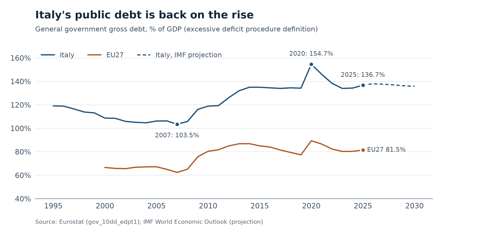
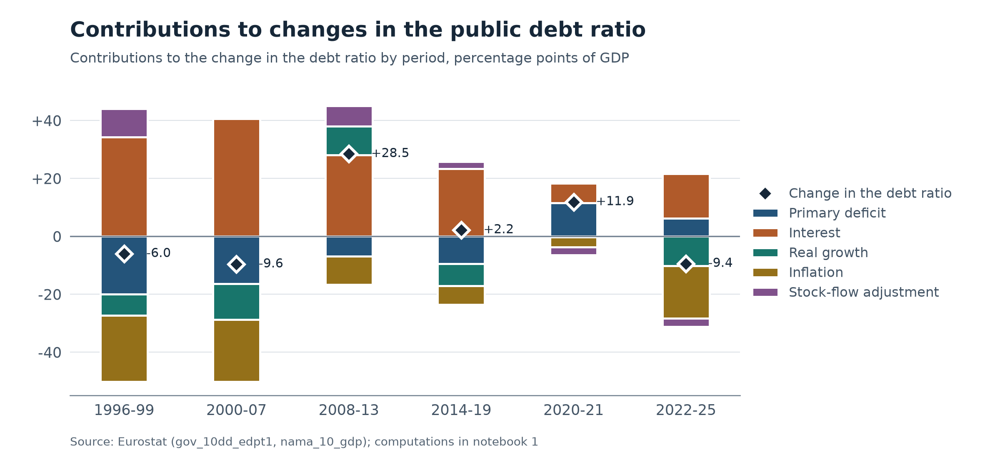
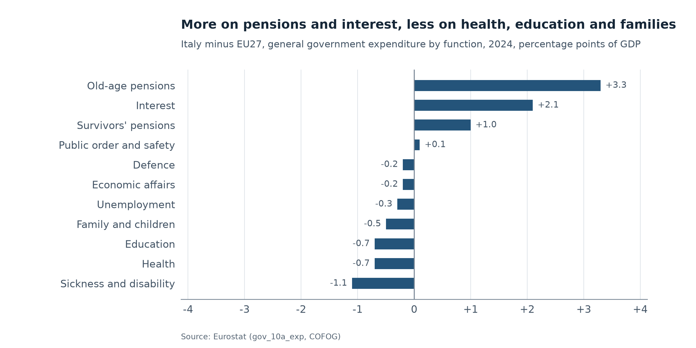
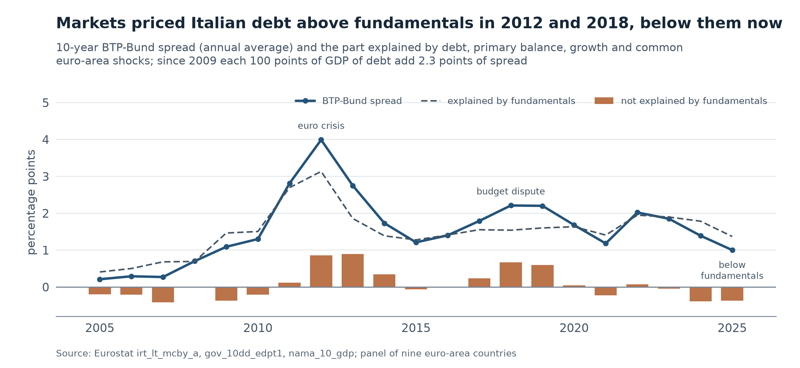
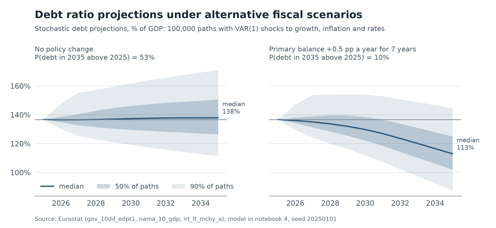
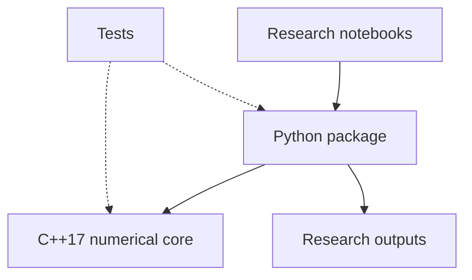

# Italian Public Debt

[](https://github.com/paolo993788/italian-public-debt/actions/workflows/ci.yml)

This project studies the drivers of Italy's public debt, how its spending and revenues compare with those of other EU economies, and how growth, interest rates and fiscal policy affect debt sustainability. The analysis combines debt accounting and panel econometrics with an illustrative stochastic debt model implemented in C++ and analysed in Python.

## Data revisions and research findings

Eurostat's October 2026 excessive deficit procedure (EDP) notification puts 2025 general government gross debt at **136.7% of GDP for Italy** and **81.5% for the EU27**. The April notification reported 137.1% and 81.7% respectively. Upward revisions to GDP explain the lower ratios in both cases, partly offset by revisions to nominal debt. The historical notebook outputs below use the earlier vintage unless explicitly dated otherwise. [April notification](https://ec.europa.eu/eurostat/web/products-euro-indicators/w/2-22042026-ap) · [October notification](https://ec.europa.eu/eurostat/web/products-euro-indicators/w/2-21102026-ap) · [Eurostat revision note](https://ec.europa.eu/eurostat/documents/d/government-finance-statistics/edp-notif-2026-oct-main-revisions)

- **Recent observations.** In the October EDP vintage, Italy's debt rose from 134.3% of GDP in 2024 to 136.7% in 2025. In 2025 the primary surplus was 0.7% of GDP and interest expenditure was 3.8% of GDP.
- **The debt was built mainly in the 1970s and 1980s** (Bank of Italy long-run series): spending commitments grew without matching revenues and, after the 1981 end of monetary financing, real interest rates exceeded growth while primary deficits persisted for a decade. The ratio rose from about 57% of GDP in 1980 to about 120% in 1994.
- **Since the 1990s the snowball, not the primary balance, has driven the debt.** The primary balance exceeded its debt-stabilising level in 20 of the 30 years since 1996. In 2008-2013 the ratio rose by 28 points: primary surpluses lowered it by 7 points, but interest added 28 and the recessions 10.
- **Missed opportunities** (mechanical counterfactuals, without feedback effects): keeping the 1997-2000 primary surplus (4.8% of GDP) during the low-rate years 2001-2007 would give a 2025 ratio of about 110% instead of 137%; growing like the EU27 since 2001 about 109%; holding the 2020-2023 primary balance at its 2019 level about 113%; an effective interest rate one point lower since 2012 about 120%.
- **Budget structure** (COFOG 2024, % of GDP): old-age pensions 13.9 against 10.7 in the EU, interest 4.0 against 1.9; less than the EU on education (4.0 against 4.7), health (6.6 against 7.3) and family benefits (1.5 against 2.0).
- **Fiscal policy has not reacted systematically to debt**: in a Bohn (1998) regression on 1996-2025 the response of the primary balance to the debt ratio is not positive in any specification (full sample, pandemic and tax-credit dummies, pre-pandemic sample).
- **Growth is the missing ingredient**: real GDP grew by 0.4% a year in 2001-2025 against 1.4% in the EU27. The employment rate (20-64) is 67.6% against 76.1% in the EU, 58.0% against 71.3% for women; R&D spending is 1.4% of GDP against 2.2%. Closing the employment gap over ten years would bring the ratio to about 114% in 2035 instead of about 136%.
- **Little fiscal space, and markets watch debt more than before 2008.** In a panel of 12 advanced EU economies (1996-2025, country and year effects) primary balances respond more strongly to debt between about 56% and 127% of GDP and less beyond: Italy is past that fatigue point. On this average behaviour Italy's debt limit is about 141% of GDP at today's interest-growth differential (0.8 points), only 4 points above current debt; there is no limit above current debt if the differential widens to 1.7 points. The estimate is very sensitive to the specification: with Greece's programme years in the panel the limit rises to 229%. Euro-area spreads rise by 2.3 points per 100 points of debt since 2009, twice the earlier slope; the BTP-Bund spread exceeded fundamentals by 0.6-0.9 points in 2012-2013 and 2018-2019 and is about 0.4 points below them in 2024-2025.
- **Illustrative sustainability scenarios.** With the revised inputs, the deterministic ratio reaches 135.8% in 2035 under the no-policy-change baseline. In the 100,000-path simulation, debt in 2035 exceeds the 2025 ratio in 52.8% of baseline paths and 10.1% of paths with a 0.5 percentage point improvement in the primary balance each year for seven years. The earlier vintage gave approximately 52% and 9%, respectively. These estimates depend on the specified assumptions and resampled shocks.

Figures before 1995 come from the Bank of Italy literature cited in the notebooks; the IMF series used for the long view starts in 1988.

## Charts

<picture>
  <source media="(prefers-color-scheme: dark)" srcset="docs/figures/debt_ratio-dark.png">
  
</picture>

<picture>
  <source media="(prefers-color-scheme: dark)" srcset="docs/figures/debt_decomposition-dark.png">
  
</picture>

<picture>
  <source media="(prefers-color-scheme: dark)" srcset="docs/figures/spending_gap-dark.png">
  
</picture>

<picture>
  <source media="(prefers-color-scheme: dark)" srcset="docs/figures/spread_fundamentals-dark.png">
  
</picture>

<picture>
  <source media="(prefers-color-scheme: dark)" srcset="docs/figures/debt_fan_chart-dark.png">
  
</picture>

The figures use the archived source inputs identified in the figure manifest. The debt history uses the October 2026 EDP vintage, and the fan chart is a model-based simulation. The IMF series shown in the debt history is a separate projection.

[Figure generation and provenance](docs/figure-style.md#reproducing-the-figures)

## Catalogue

| Item | Question | Data |
| --- | --- | --- |
| [`scripts/public_debt`](scripts/public_debt/README.md) (library) | Debt accounting, fiscal analysis, growth accounting and a C++ engine for projections, fan charts and adjustment grids | Eurostat, IMF loaders |
| [1. Debt history and decomposition](notebooks/debt_dynamics/01_debt_history_and_decomposition.ipynb) | How was the debt built, which factors drove it in each period, and what if different choices had been made? | Eurostat EDP and national accounts, IMF WEO, optional Bank of Italy series since 1861 |
| [2. Reading the public accounts](notebooks/public_accounts/02_state_budget_analysis.ipynb) | Where does the money go and come from, compared with peers? How much of the deficit is structural? Has policy reacted to debt? | Eurostat government finance statistics (ESA 2010, COFOG) |
| [3. Macro and micro drivers](notebooks/growth_drivers/03_macro_micro_drivers.ipynb) | Why has Italy grown less, and what would closing the employment and productivity gaps be worth for the debt? | Eurostat national accounts, labour market, demography, R&D, bond yields |
| [4. Sustainability and policy options](notebooks/sustainability/04_debt_sustainability_and_policy_options.ipynb) | Where is the debt heading, how large an adjustment is needed, and which policy mix works best? | Eurostat, model-based scenarios |
| [5. Fiscal space and sovereign spreads](notebooks/sustainability/05_fiscal_space_and_sovereign_spreads.ipynb) | Do governments tire of adjusting at high debt, how far is Italy from its debt limit, and how much do markets charge for debt? | Eurostat EDP, national accounts and 10-year yields for 13 EU countries |
| [Guide: how to read Italy's public accounts](docs/reading_public_accounts.md) | State budget versus general government, balances, budget cycle, data sources, analysis workflow, glossary | |
| [Fiscal econometrics in R](notebooks/r_crosschecks/fiscal_econometrics_r.ipynb) (R) | Do R's econometric packages reproduce the decomposition, output gap and fiscal reaction estimates, and when did fiscal regimes change? | Eurostat `gov_10dd_edpt1`, `nama_10_gdp` |

## Architecture

Research notebooks call the Python package. Computationally intensive methods are implemented in C++17 and exposed through pybind11.



| Component | Source | Responsibility |
| --- | --- | --- |
| Data | [`data.py`](scripts/public_debt/public_debt/data.py) | Eurostat and IMF data acquisition. |
| Public accounts | [`accounting.py`](scripts/public_debt/public_debt/accounting.py), [`fiscal.py`](scripts/public_debt/public_debt/fiscal.py) | Debt accounting and fiscal analysis. |
| Debt sustainability | [`dsa.py`](scripts/public_debt/public_debt/dsa.py), [`fiscal_space.py`](scripts/public_debt/public_debt/fiscal_space.py) | Stochastic projections and fiscal space. |
| Numerical core | [C++ source](scripts/public_debt/cpp/) | Numerical kernels and native bindings. |
| Visualisation | [`figstyle.py`](scripts/public_debt/public_debt/figstyle.py), [`readme_figures.py`](scripts/public_debt/public_debt/readme_figures.py) | Figure styling and reproducible research outputs. |
| Validation suite | [Python tests](tests/public_debt/), [C++ tests](scripts/public_debt/cpp/tests/) | Numerical and implementation checks. |

Implementation and installation details: [package documentation](scripts/public_debt/README.md).

## Getting started

Requirements: Python 3.10 or later and a C++17 compiler. From the repository root:

```bash
python -m venv .venv
source .venv/bin/activate            # Windows PowerShell: .venv\Scripts\Activate.ps1
python -m pip install -r scripts/public_debt/requirements.txt
python -m pip install -e scripts/public_debt
python -m pytest tests/public_debt
```

For the exact versions used by CI, install `scripts/public_debt/requirements-lock.txt` instead of `requirements.txt`. The standalone C++ tests and sanitizer builds are described in the [library README](scripts/public_debt/README.md#c-unit-tests-and-sanitizers).

Open the notebooks in Visual Studio Code (extensions *Python*, *Jupyter* and *C/C++*) in numerical order and select the `.venv` environment as kernel. Official data are downloaded and cached on first use; `PUBLIC_DEBT_DATA_MODE=synthetic` runs them offline on random placeholder data.

The notebooks include saved outputs from official data, so tables and figures can be read on GitHub. The earlier analyses use the data available in September 2026. The debt sustainability notebook records its input vintage separately. The R notebooks in [`notebooks/r_crosschecks/`](notebooks/r_crosschecks/README.md) recompute selected results with independent packages. They need R 4.2 or later. Run `Rscript notebooks/r_crosschecks/install_packages.R` once and select the **R** kernel.

## Repository layout

```text
.
├── scripts/public_debt/   C++ engine (cpp/), Python package, build and dependency files
├── notebooks/             debt_dynamics/, public_accounts/, growth_drivers/, sustainability/, r_crosschecks/ (R)
├── docs/                  guide to the public accounts, project template, publishing workflow
├── tests/public_debt/     validation suite (pytest)
├── data/                  download cache and optional external series (ignored by Git)
└── outputs/               generated figures and tables (ignored by Git)
```

## Principles

- **Official data first**: Eurostat, ISTAT, Bank of Italy, MEF, European Commission, IMF; every dataset, perimeter and vintage is stated.
- **Facts, estimates and judgements are kept apart**: numbers computed from data, estimates from the literature (with sources) and policy assessments are labelled as such. The analysis is non-partisan: it evaluates policies by their measurable effects.
- **Reproducible and tested**: accounting identities and limiting cases are tested; simulations use fixed seeds.

## Development workflow

Changes follow the [publishing workflow](docs/publishing.md). Every pull request runs the [CI workflow](.github/workflows/ci.yml): lint, the Python tests on Python 3.10-3.12, the C++ tests with GCC and Clang and under sanitizers, and every Python notebook offline on synthetic data. The [`CLAUDE.md`](CLAUDE.md) file provides project instructions for [Claude Code](https://claude.com/claude-code).

## Disclaimer

Research and educational material. Projections depend on stated assumptions and are not official forecasts.

## License

Released under the [MIT License](LICENSE).
